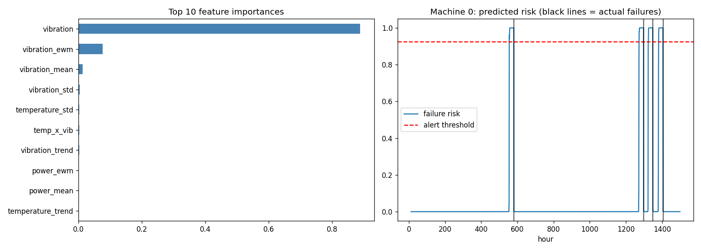

# Predictive Maintenance AI

Predict machine failures **within the next 24 hours** from temperature, vibration and power-consumption sensor data, using time-series feature engineering and a Gradient Boosting classifier.



> **Note:** The default demo uses **synthetic (simulated) data**, so the scores below show that the pipeline works, not how it will perform on real equipment. Expect lower numbers on real data.

## How it works

1. **Data**: simulates 60 machines whose sensors drift upward in the 48 hours before each failure (or load your own CSV).
2. **Features**: per machine, rolling mean / std / max / trend / EWM for each sensor, plus a temperature × vibration interaction.
3. **Labels**: a row is positive if the machine fails within the next 24 hours (`HORIZON`).
4. **Model**: `GradientBoostingClassifier` with positive-class weighting for imbalance.
5. **Evaluation**: data is split **by machine** into train / validation / test, so the test machines are never seen in training. The alert threshold is chosen on the validation set only, and results are reported on the untouched test set.
6. **Inference**: `predict_risk()` scores recent readings from a live machine.

## Quick start

```bash
git clone https://github.com/ajinkyaadsul20-r/predictive-maintenance-ai.git
cd predictive-maintenance-ai
python -m venv .venv && source .venv/bin/activate   # Windows: .venv\Scripts\activate
pip install -r requirements.txt
python predictive_maintenance.py
```

This trains the model, prints metrics, saves `pm_model.joblib` and `pm_results.png`, and scores two example machines.

## Example output (synthetic data)

| Metric | Value |
|---|---|
| ROC-AUC | 0.998 |
| Precision (fails < 24h) | 0.98 |
| Recall (fails < 24h) | 0.98 |

## Use your own data

Replace `generate_data()` with `load_csv()` in the `__main__` block:

```python
data = load_csv("your_data.csv")
```

Required columns:

| Column | Description |
|---|---|
| `machine_id` | Identifier for each machine |
| `hour` | Sortable time index (hourly readings assumed) |
| `temperature` | Temperature reading |
| `vibration` | Vibration reading |
| `power` | Power consumption |
| `failure` | `1` at the moment of failure, otherwise `0` |

Tune `HORIZON` (prediction window) and `WINDOW` (feature window) at the top of the script to match your sampling rate.

## Score live readings

```python
from predictive_maintenance import predict_risk

# DataFrame with >= 15 recent hourly rows for ONE machine:
# machine_id, hour, temperature, vibration, power
risk, alert = predict_risk(recent_df)
print(f"Failure risk (24h): {risk:.1%}  Alert: {alert}")
```

## Limitations

- Demo data is synthetic and cleanly separable; real sensor data is noisier.
- Metrics are row-level. For production, evaluate at event level (how early was each failure flagged?).
- Feature importances reflect the simulation (vibration is made the strongest signal), not real-world insight.
- Real failure labels are often sparse or inconsistent, so focus on precision and recall rather than accuracy.

## Ideas for extension

- Remaining-useful-life (RUL) regression
- LSTM / temporal CNN models
- Streaming inference with Kafka or MQTT
- Dashboard with Streamlit

## License

MIT. See [LICENSE](LICENSE).
